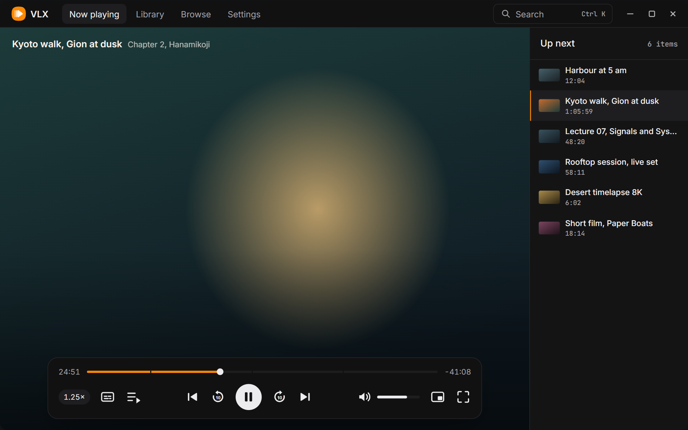
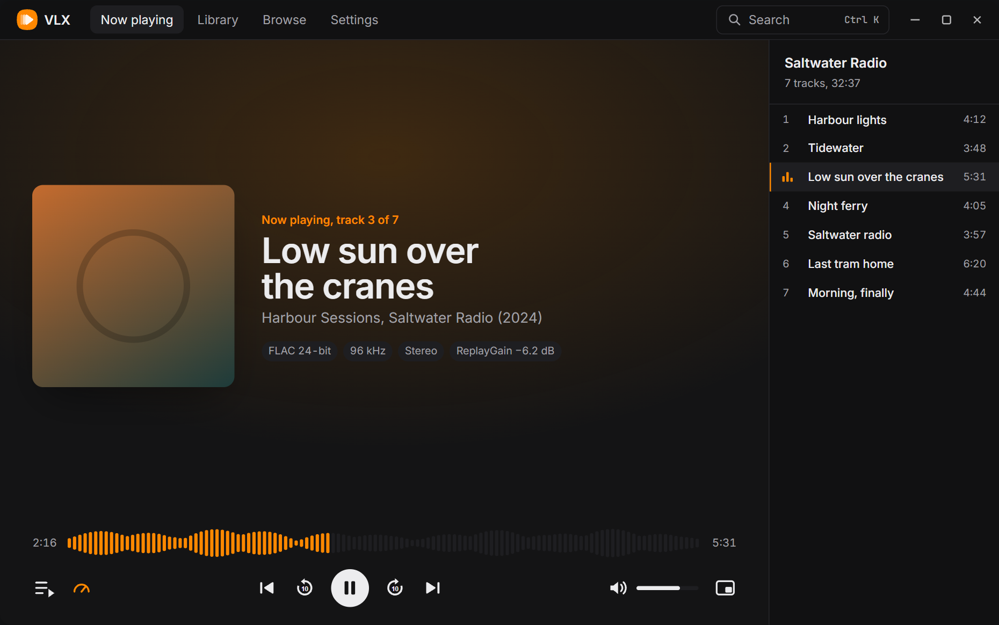
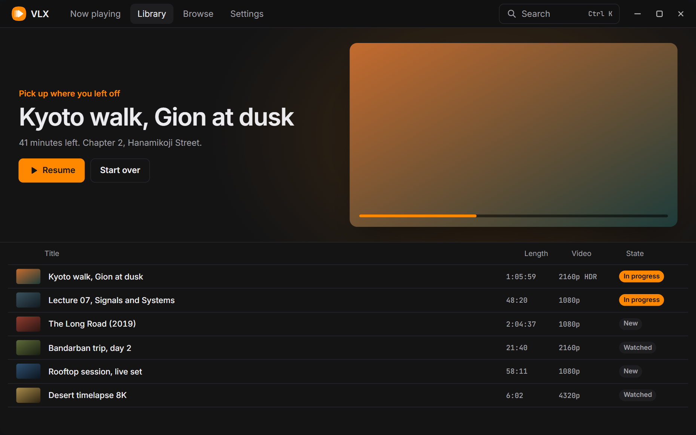
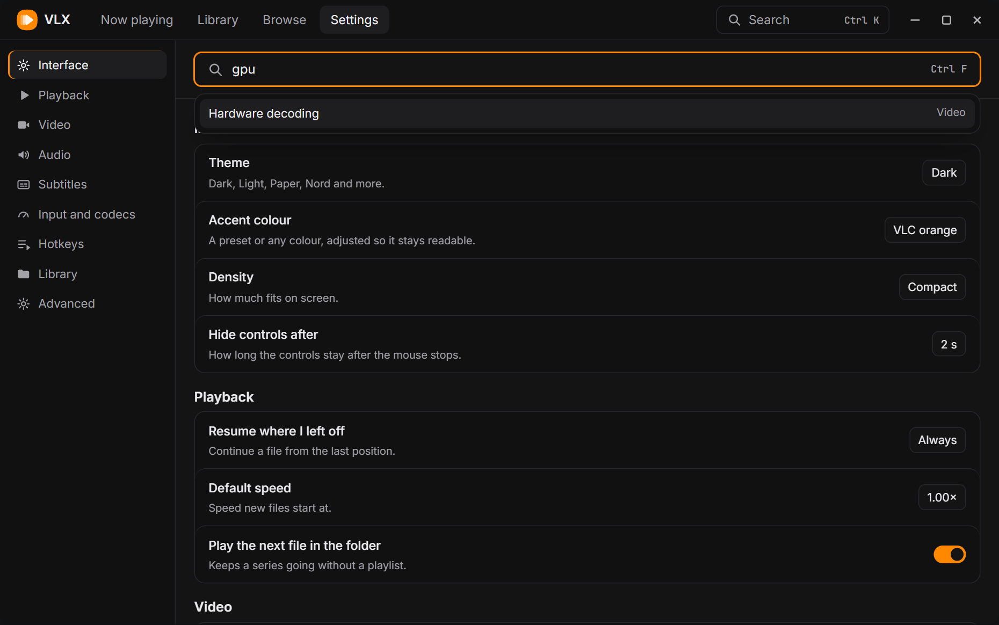
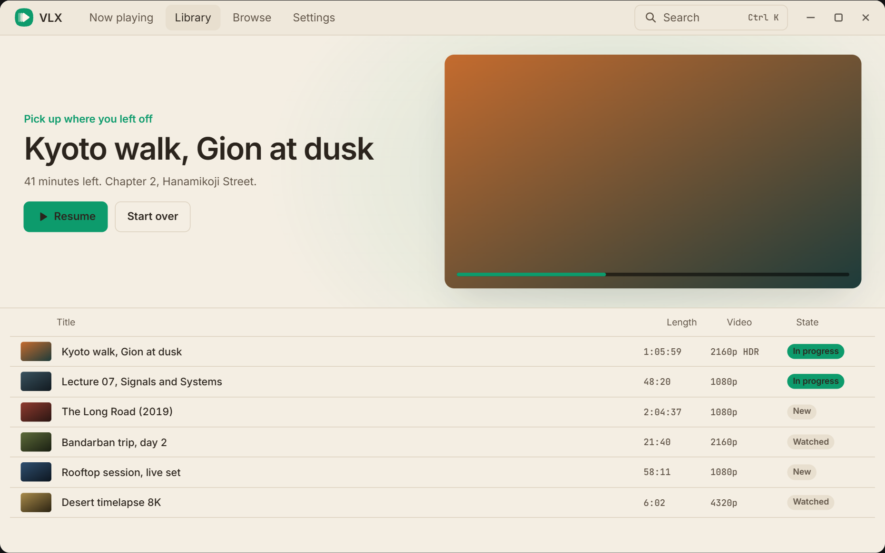

<p align="center"></p>

<h1 align="center">VLX</h1>

**VLX is a personal, open source fork of [VLC media player](https://www.videolan.org/vlc/)**
with a more modern, fluid UI and tuned defaults. Everything that makes VLC great (the engine,
the codecs, "plays everything") is VLC's work. VLX only reskins and tunes it.

> VLX is **not** affiliated with or endorsed by VideoLAN. "VLC" and the cone logo are
> trademarks of VideoLAN. VLX uses its own name and icon for that reason.

## Goals

1. **UI first.** A calmer, more modern Qt/QML interface: consistent spacing, softer surfaces,
   smooth transitions, a refreshed player view and media library.
2. **Performance second.** Faster startup and snappier UI through build flags and defaults
   (LTO, lazy-loaded views) and by not building rarely used modules (see `extras/vlx/vlx.ini`).
3. **Low upkeep.** Small, contained diffs, so a new VLC release merges in with little work.

Features beyond that come later.

## Status

Early. The design is locked in [`DESIGN.md`](DESIGN.md): the Lean direction, the Ripple echo icon and a fully customizable player. The interface
isn't built yet, so the screenshots below are design previews (HTML mock-ups), not the running app.

## Screenshots (design previews)

| Video | Audio |
|---|---|
|  |  |
| **Library** | **Settings search** |
|  |  |

Themes and accents are user-chosen. Here's the library in the Paper theme with the Emerald accent:



Icon files (SVG, PNG from 16 to 512 px, and a Windows `.ico`) are in [`extras/vlx/brand/`](extras/vlx/brand/).

## Download

Windows x64 builds come from GitHub Actions: see [Releases](https://github.com/TriptoAfsin/vlx/releases) for the setup
and the portable `.7z`. There are no Linux or macOS builds; VLX is made for Windows.

## Building

VLX builds the same way VLC does. On Windows that means a mingw-w64 toolchain inside WSL, msys2
or Docker. Start with [`doc/BUILD-win32.md`](doc/BUILD-win32.md). [`VERIFY.md`](VERIFY.md) lists
the exact commands used to check a change.

```sh
# WSL / Linux, cross-compiling for Windows x64, with prebuilt contribs
./extras/package/win32/build.sh -a x86_64 -p -m
```

## Branches and remotes

| Ref | What it is |
|---|---|
| `main` | VLX: upstream VLC plus the VLX changes |
| `master` | Untouched mirror of `upstream/master` |
| `upstream` remote | `https://github.com/videolan/vlc.git` |
| `origin` remote | `https://github.com/TriptoAfsin/vlx.git` |

To take a newer VLC, follow [`UPSTREAM.md`](UPSTREAM.md). VLX follows pinned 4.0-dev commits until VLC 4.0 ships, then release tags.

## Credits and license

All credit for the media engine, the codecs and the original interface goes to the
[VideoLAN](https://www.videolan.org) team and VLC's contributors (see [`AUTHORS`](AUTHORS) and
[`THANKS`](THANKS)). The original VLC README is kept at [`README.VLC.md`](README.VLC.md).

VLX keeps VLC's licensing: the application is **GPLv2 or later** ([`COPYING`](COPYING)), and libVLC is
**LGPLv2.1 or later** ([`COPYING.LIB`](COPYING.LIB)). Every VLX change is released under the same terms.
